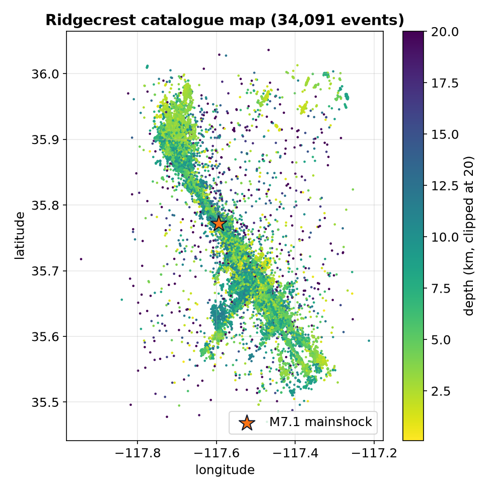

# Advanced Clustering — A Hands-On Tutorial

> **Course note:** this code was provided for the **Data Mining** course taught by **Professor Nadimi**. Presenter: Maryam Mahmoudi.

Learn advanced clustering by *running and reading* real code. The notebook [Advanced_Clustering_Worked_Examples.ipynb](Advanced_Clustering_Worked_Examples.ipynb) works through two real datasets, and this README explains every part of it: the idea, the code line by line, and the figure it produces.

## What you will learn

| Topic | Algorithms | Dataset |
|---|---|---|
| Partitioning | K-means (Lloyd iterations by hand) | Wholesale customers |
| Hierarchical | AGNES (agglomerative), DIANA (divisive), 7 linkage rules, dendrogram cutting | Wholesale customers |
| Scalable / graph-based | BIRCH, CHAMELEON idea | Wholesale customers |
| Density-based | DBSCAN (by hand), OPTICS, HDBSCAN | Ridgecrest earthquakes |

## Contents

1. [Quick start: how to run the code](#1-quick-start-how-to-run-the-code)
2. [Project layout](#2-project-layout)
3. [The datasets](#3-the-datasets)
4. [Clustering in one page](#4-clustering-in-one-page)
5. [Code walkthrough, Part A: setup and helpers](#5-part-a-setup-and-helpers)
6. [Code walkthrough, Part B: Wholesale customers (hierarchical and K-means)](#6-part-b-wholesale-customers)
7. [Code walkthrough, Part C: Ridgecrest earthquakes (density-based)](#7-part-c-ridgecrest-earthquakes)
8. [Choosing an algorithm](#8-choosing-an-algorithm)
9. [Exercises](#9-exercises)
10. [Credits and licences](#10-credits-and-licences)

---

## 1. Quick start: how to run the code

You need Python 3.11+ (the results shipped here were produced with Python 3.12). No internet is needed at run time because both datasets are in `data/`.

**Windows (PowerShell)**

```powershell
git clone https://github.com/maryammahmoudi1993/Advanced_Clustering_Notebook_Package.git
cd Advanced_Clustering_Notebook_Package
python -m venv .venv
.venv\Scripts\Activate.ps1
pip install -r requirements.txt
pip install jupyter
jupyter notebook Advanced_Clustering_Worked_Examples.ipynb
```

**macOS / Linux**

```bash
git clone https://github.com/maryammahmoudi1993/Advanced_Clustering_Notebook_Package.git
cd Advanced_Clustering_Notebook_Package
python -m venv .venv && source .venv/bin/activate
pip install -r requirements.txt jupyter
jupyter notebook Advanced_Clustering_Worked_Examples.ipynb
```

Then choose **Kernel → Restart & Run All**. (In VS Code: open the `.ipynb`, pick the `.venv` kernel, click *Run All*.)

What happens when it runs:

* all plots are written to `figs/` (the images you see below),
* all numbers are written to `results/results.json`,
* the derived CSV files in `data/` are regenerated,
* about 20 assertions check that the hand-written algorithms give the same answer as scikit-learn/SciPy. The last line printed is `All assertions passed.`

Notes:

* Run the notebook **from the project folder**: all paths are relative (`data/`, `figs/`, `results/`).
* The notebook uses recent library versions (see `requirements.txt`). If `pip install` cannot find one, install the newest available versions; the algorithms do not change.
* Full run time is typically a few minutes; the slowest part is the DBSCAN timing comparison in section 2.4.

## 2. Project layout

```text
Advanced_Clustering_Notebook_Package/
├── Advanced_Clustering_Worked_Examples.ipynb   <- the code explained below
├── requirements.txt                            <- pinned package versions
├── data/                                       <- original datasets + derived CSVs  (see data/README.md)
├── datasets/                                   <- raw downloads under their original names
├── figs/                                       <- figures produced by the notebook
├── results/results.json                        <- every number used in the lecture slides
├── docs/images/                                <- dataset overview figures
└── scripts/make_dataset_figures.py             <- regenerates docs/images
```

## 3. The datasets

Full column dictionaries are in [data/README.md](data/README.md). In short:

**Wholesale customers (UCI)** - 440 customers of a wholesale distributor, with their annual spending on six product categories (`Fresh, Milk, Grocery, Frozen, Detergents_Paper, Delicassen`) plus `Channel` (Horeca / Retail) and `Region`. We cluster on `log10(Fresh)` and `log10(Grocery)`.


**Ridgecrest 2019 earthquakes (USGS)** - 34,091 relocated earthquakes from the 2019 Ridgecrest, California sequence, including the M7.1 mainshock. We cluster the 3,505 epicentres from the 24 hours after the mainshock.



