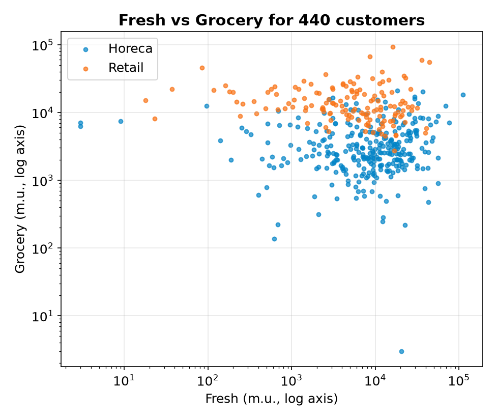
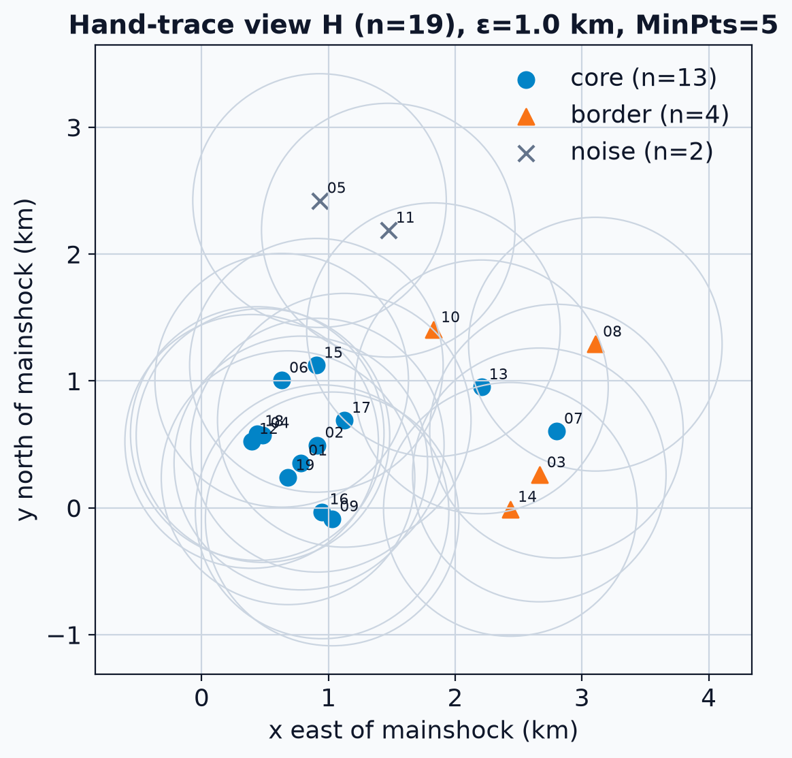

# Advanced Clustering — A Hands-On Tutorial

> **Course note:** this code was provided for the **Data Mining** course taught by **Professor Nadimi**. Presenter: Maryam Mahmoudi.

Learn advanced clustering by *running and reading* real code. The notebook [Advanced_Clustering_Worked_Examples.ipynb](Advanced_Clustering_Worked_Examples.ipynb) works through two real datasets, and this README explains every part of it: the idea, the code line by line, and the figure it produces.

## What you will learn

| Topic | Algorithms | Dataset |
|---|---|---|
| Partitioning | K-means (Lloyd iterations by hand) | Wholesale customers |
| Hierarchical | AGNES (agglomerative), DIANA (divisive), 7 linkage rules, dendrogram cutting | Wholesale customers |
| Scalable / graph-based | BIRCH, CHAMELEON idea | Wholesale customers |
| Density-based | DBSCAN (by hand), OPTICS, HDBSCAN | Ridgecrest earthquakes |

## Contents

1. [Quick start: how to run the code](#1-quick-start-how-to-run-the-code)
2. [Project layout](#2-project-layout)
3. [The datasets](#3-the-datasets)
4. [Clustering in one page](#4-clustering-in-one-page)
5. [Code walkthrough, Part A: setup and helpers](#5-part-a-setup-and-helpers)
6. [Code walkthrough, Part B: Wholesale customers (hierarchical and K-means)](#6-part-b-wholesale-customers)
7. [Code walkthrough, Part C: Ridgecrest earthquakes (density-based)](#7-part-c-ridgecrest-earthquakes)
8. [Choosing an algorithm](#8-choosing-an-algorithm)
9. [Exercises](#9-exercises)
10. [Credits and licences](#10-credits-and-licences)

---

## 1. Quick start: how to run the code

You need Python 3.11+ (the results shipped here were produced with Python 3.12). No internet is needed at run time because both datasets are in `data/`.

**Windows (PowerShell)**

```powershell
git clone https://github.com/maryammahmoudi1993/Advanced_Clustering_Notebook_Package.git
cd Advanced_Clustering_Notebook_Package
python -m venv .venv
.venv\Scripts\Activate.ps1
pip install -r requirements.txt
pip install jupyter
jupyter notebook Advanced_Clustering_Worked_Examples.ipynb
```

**macOS / Linux**

```bash
git clone https://github.com/maryammahmoudi1993/Advanced_Clustering_Notebook_Package.git
cd Advanced_Clustering_Notebook_Package
python -m venv .venv && source .venv/bin/activate
pip install -r requirements.txt jupyter
jupyter notebook Advanced_Clustering_Worked_Examples.ipynb
```

Then choose **Kernel → Restart & Run All**. (In VS Code: open the `.ipynb`, pick the `.venv` kernel, click *Run All*.)

What happens when it runs:

* all plots are written to `figs/` (the images you see below),
* all numbers are written to `results/results.json`,
* the derived CSV files in `data/` are regenerated,
* about 20 assertions check that the hand-written algorithms give the same answer as scikit-learn/SciPy. The last line printed is `All assertions passed.`

Notes:

* Run the notebook **from the project folder**: all paths are relative (`data/`, `figs/`, `results/`).
* The notebook uses recent library versions (see `requirements.txt`). If `pip install` cannot find one, install the newest available versions; the algorithms do not change.
* Full run time is typically a few minutes; the slowest part is the DBSCAN timing comparison in section 2.4.

## 2. Project layout

```text
Advanced_Clustering_Notebook_Package/
├── Advanced_Clustering_Worked_Examples.ipynb   <- the code explained below
├── requirements.txt                            <- pinned package versions
├── data/                                       <- original datasets + derived CSVs  (see data/README.md)
├── datasets/                                   <- raw downloads under their original names
├── figs/                                       <- figures produced by the notebook
├── results/results.json                        <- every number used in the lecture slides
├── docs/images/                                <- dataset overview figures
└── scripts/make_dataset_figures.py             <- regenerates docs/images
```

## 3. The datasets

Full column dictionaries are in [data/README.md](data/README.md). In short:

**Wholesale customers (UCI)** - 440 customers of a wholesale distributor, with their annual spending on six product categories (`Fresh, Milk, Grocery, Frozen, Detergents_Paper, Delicassen`) plus `Channel` (Horeca / Retail) and `Region`. We cluster on `log10(Fresh)` and `log10(Grocery)`.



**Ridgecrest 2019 earthquakes (USGS)** - 34,091 relocated earthquakes from the 2019 Ridgecrest, California sequence, including the M7.1 mainshock. We cluster the 3,505 epicentres from the 24 hours after the mainshock.


---

## 4. Clustering in one page

**Clustering** groups objects so that objects in the same group are more similar to each other than to those in other groups. There is no "correct answer" column: it is *unsupervised* learning, so you judge a result by whether it is useful and stable.

Every clustering method must answer three questions:

1. **How do we measure closeness?** Here: Euclidean distance `d(x, y) = sqrt(Σ (xᵢ − yᵢ)²)`.
2. **What is a cluster?** A compact blob (K-means), a branch of a tree (hierarchical), or a dense region (DBSCAN).
3. **How many clusters?** Fixed in advance (K-means), chosen by cutting a tree (hierarchical), or discovered from density (DBSCAN).

| Family | Idea | Needs K? | Finds odd shapes? | Handles noise? |
|---|---|---|---|---|
| **K-means** | K centres; assign each point to its nearest centre; move centres to the mean; repeat | yes | no (round blobs) | no |
| **Hierarchical (AGNES)** | start with every point alone; repeatedly merge the two closest clusters | no (cut the tree) | depends on linkage | partly |
| **Hierarchical (DIANA)** | start with one cluster; repeatedly split | no | depends | partly |
| **BIRCH** | summarise points into tiny Clustering Features, then cluster the summaries | optional | no | partly |
| **DBSCAN** | a cluster = a dense region; sparse points are noise | no | yes | yes |
| **OPTICS / HDBSCAN** | DBSCAN without one fixed density threshold | no | yes | yes |

### The key ideas used in the notebook

* **Feature scaling matters.** Distances are dominated by the largest numbers, so we use `log10` for the skewed spending data.
* **K-means objective:** minimise `J = Σₖ Σ_{x∈Cₖ} ‖x − μₖ‖²` (total squared distance to the cluster centre). Each Lloyd iteration can only decrease `J`.
* **Linkage** = the rule that defines the distance *between two clusters* in hierarchical clustering:

| Linkage | Distance between clusters A and B | Typical behaviour |
|---|---|---|
| Single | smallest distance between a point of A and a point of B | long "chains" |
| Complete | largest such distance | compact clusters |
| Average | mean of all cross-pair distances | in between |
| Centroid | distance between the cluster means | can have *inversions* |
| Median (WPGMC) | distance between midpoint representatives | can have *inversions* |
| Medoid | distance between the most central real members | classroom rule |
| Ward | increase in within-cluster squared error when merged | balanced, K-means-like |

* **Inversion:** a merge that happens at a *lower* height than the previous merge, so the dendrogram "goes backwards". It can occur with Centroid and Median linkage.
* **DBSCAN** has two parameters: radius `ε` (eps) and `MinPts`. A point is **core** if at least `MinPts` points (itself included) lie within `ε`; **border** if it is not core but lies within `ε` of a core point; otherwise **noise**. A cluster is a set of core points connected through `ε`-neighbourhoods plus their border points.



*Figure: blue circles are core points, orange triangles are border points, grey crosses are noise. The thin circles have radius ε = 1 km.*

---

## 5. Part A: setup and helpers

Notebook cell `[2]`. This cell prepares everything the rest of the notebook needs.

```python
import json, itertools, time, platform, importlib.metadata as md
from pathlib import Path
import numpy as np, pandas as pd
import matplotlib; matplotlib.use("Agg")
import matplotlib.pyplot as plt
```

* **Line 1** - standard-library tools: `json` (save results), `itertools` (all pairs of clusters), `time` (timing algorithms), `platform` and `importlib.metadata` (print library versions for reproducibility).
* **Line 2** - `Path` gives portable file paths (works on Windows and Linux).
* **Line 3** - `numpy` for arrays, `pandas` for tables.
* **Line 4** - `matplotlib.use("Agg")` selects a backend that draws straight to files, so plots are saved to `figs/` instead of popping up.

```python
from scipy.cluster.hierarchy import linkage, fcluster, dendrogram, cophenet
from scipy.spatial.distance import pdist, squareform
from scipy.optimize import linear_sum_assignment
from scipy.stats import skew
from sklearn.cluster import KMeans, DBSCAN, OPTICS, HDBSCAN, Birch
from sklearn.neighbors import NearestNeighbors
from sklearn.metrics import adjusted_rand_score, silhouette_score
from pyproj import Transformer
```

| Import | What it does |
|---|---|
| `linkage` | builds the hierarchical tree (a *linkage matrix*) |
| `fcluster` | cuts the tree into flat clusters |
| `dendrogram` | draws the tree |
| `cophenet` | (imported; the notebook computes its own cophenetic distance) |
| `pdist`, `squareform` | all pairwise distances as a vector / as a square matrix |
| `linear_sum_assignment` | the Hungarian algorithm: matches cluster labels between two clusterings |
| `skew` | measures how lopsided a distribution is |
| `KMeans, DBSCAN, OPTICS, HDBSCAN, Birch` | the clustering algorithms |
| `NearestNeighbors` | fast "who is within ε of me?" searches |
| `adjusted_rand_score` | **ARI**: agreement of two clusterings (1 = identical, ≈0 = random) |
| `silhouette_score` | how well separated clusters are (−1…1, higher = better) |
| `Transformer` | converts latitude/longitude to kilometres |

```python
DATA, FIG, OUT = Path("data"), Path("figs"), Path("results")
for p in (FIG, OUT): p.mkdir(exist_ok=True)
VERS = {k: md.version(k) for k in [...]}
```

Defines the three folders and creates `figs/` and `results/` if missing. `VERS` records exact library versions and prints them.

```python
INK, BLUE, TEAL, ORANGE, GRID, ICE = "#0F172A", "#0284C7", "#0D9488", "#F97316", "#CBD5E1", "#F8FAFC"
CL = [BLUE, ORANGE, TEAL, "#7C3AED", "#CA8A04", "#BE123C", "#64748B", INK]
MK = ["o", "s", "^", "D", "v", "P", "X", "h"]
plt.rcParams.update({...})
```

A fixed colour palette `CL` and marker list `MK`. Cluster *k* always gets colour `CL[k]` **and** shape `MK[k]`, so figures stay readable in black-and-white. `rcParams` sets the look of every plot (background, fonts, 200 dpi).

```python
RES = {"versions": VERS}
def save(fig, name): ...
def jsonable(o): ...
def canon(lab): ...
def prov_csv(df, path, lines): ...
```

| Helper | Purpose |
|---|---|
| `RES` | a dictionary that collects every number; written to `results/results.json` at the end |
| `save(fig, name)` | saves a figure into `figs/` and closes it |
| `jsonable(o)` | converts numpy types into plain Python so they can be saved as JSON |
| `canon(lab)` | **canonical relabelling**: renames labels by order of first appearance, so `[2,2,0,1]` and `[0,0,1,2]` are recognised as the *same partition*. Cluster numbers are arbitrary, so this is needed to compare clusterings |
| `prov_csv(df, path, lines)` | writes a CSV whose first lines are `#` comments documenting the data source |

