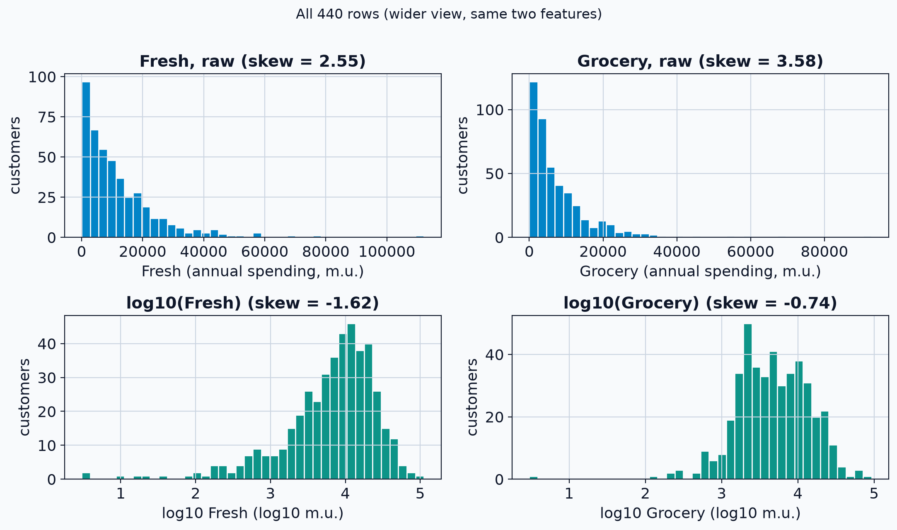
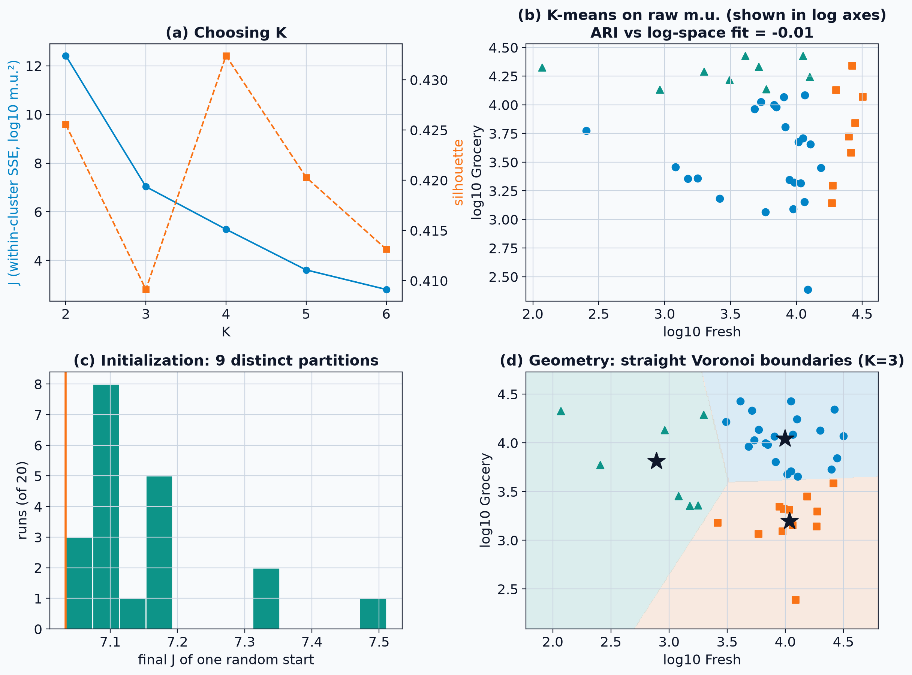

# Advanced Clustering — A Hands-On Tutorial

> **Course note:** this code was provided for the **Data Mining** course taught by **Professor Nadimi**. Presenter: Maryam Mahmoudi.

Learn advanced clustering by *running and reading* real code. The notebook [Advanced_Clustering_Worked_Examples.ipynb](Advanced_Clustering_Worked_Examples.ipynb) works through two real datasets, and this README explains every part of it: the idea, the code line by line, and the figure it produces.

## What you will learn

| Topic | Algorithms | Dataset |
|---|---|---|
| Partitioning | K-means (Lloyd iterations by hand) | Wholesale customers |
| Hierarchical | AGNES (agglomerative), DIANA (divisive), 7 linkage rules, dendrogram cutting | Wholesale customers |
| Scalable / graph-based | BIRCH, CHAMELEON idea | Wholesale customers |
| Density-based | DBSCAN (by hand), OPTICS, HDBSCAN | Ridgecrest earthquakes |

## Contents

1. [Quick start: how to run the code](#1-quick-start-how-to-run-the-code)
2. [Project layout](#2-project-layout)
3. [The datasets](#3-the-datasets)
4. [Clustering in one page](#4-clustering-in-one-page)
5. [Code walkthrough, Part A: setup and helpers](#5-part-a-setup-and-helpers)
6. [Code walkthrough, Part B: Wholesale customers (hierarchical and K-means)](#6-part-b-wholesale-customers)
7. [Code walkthrough, Part C: Ridgecrest earthquakes (density-based)](#7-part-c-ridgecrest-earthquakes)
8. [Choosing an algorithm](#8-choosing-an-algorithm)
9. [Exercises](#9-exercises)
10. [Credits and licences](#10-credits-and-licences)

---

## 1. Quick start: how to run the code

You need Python 3.11+ (the results shipped here were produced with Python 3.12). No internet is needed at run time because both datasets are in `data/`.

**Windows (PowerShell)**

```powershell
git clone https://github.com/maryammahmoudi1993/Advanced_Clustering_Notebook_Package.git
cd Advanced_Clustering_Notebook_Package
python -m venv .venv
.venv\Scripts\Activate.ps1
pip install -r requirements.txt
pip install jupyter
jupyter notebook Advanced_Clustering_Worked_Examples.ipynb
```

**macOS / Linux**

```bash
git clone https://github.com/maryammahmoudi1993/Advanced_Clustering_Notebook_Package.git
cd Advanced_Clustering_Notebook_Package
python -m venv .venv && source .venv/bin/activate
pip install -r requirements.txt jupyter
jupyter notebook Advanced_Clustering_Worked_Examples.ipynb
```

Then choose **Kernel → Restart & Run All**. (In VS Code: open the `.ipynb`, pick the `.venv` kernel, click *Run All*.)

What happens when it runs:

* all plots are written to `figs/` (the images you see below),
* all numbers are written to `results/results.json`,
* the derived CSV files in `data/` are regenerated,
* about 20 assertions check that the hand-written algorithms give the same answer as scikit-learn/SciPy. The last line printed is `All assertions passed.`

Notes:

* Run the notebook **from the project folder**: all paths are relative (`data/`, `figs/`, `results/`).
* The notebook uses recent library versions (see `requirements.txt`). If `pip install` cannot find one, install the newest available versions; the algorithms do not change.
* Full run time is typically a few minutes; the slowest part is the DBSCAN timing comparison in section 2.4.

## 2. Project layout

```text
Advanced_Clustering_Notebook_Package/
├── Advanced_Clustering_Worked_Examples.ipynb   <- the code explained below
├── requirements.txt                            <- pinned package versions
├── data/                                       <- original datasets + derived CSVs  (see data/README.md)
├── datasets/                                   <- raw downloads under their original names
├── figs/                                       <- figures produced by the notebook
├── results/results.json                        <- every number used in the lecture slides
├── docs/images/                                <- dataset overview figures
└── scripts/make_dataset_figures.py             <- regenerates docs/images
```

## 3. The datasets

Full column dictionaries are in [data/README.md](data/README.md). In short:

**Wholesale customers (UCI)** - 440 customers of a wholesale distributor, with their annual spending on six product categories (`Fresh, Milk, Grocery, Frozen, Detergents_Paper, Delicassen`) plus `Channel` (Horeca / Retail) and `Region`. We cluster on `log10(Fresh)` and `log10(Grocery)`.


**Ridgecrest 2019 earthquakes (USGS)** - 34,091 relocated earthquakes from the 2019 Ridgecrest, California sequence, including the M7.1 mainshock. We cluster the 3,505 epicentres from the 24 hours after the mainshock.


---

## 4. Clustering in one page

**Clustering** groups objects so that objects in the same group are more similar to each other than to those in other groups. There is no "correct answer" column: it is *unsupervised* learning, so you judge a result by whether it is useful and stable.

Every clustering method must answer three questions:

1. **How do we measure closeness?** Here: Euclidean distance `d(x, y) = sqrt(Σ (xᵢ − yᵢ)²)`.
2. **What is a cluster?** A compact blob (K-means), a branch of a tree (hierarchical), or a dense region (DBSCAN).
3. **How many clusters?** Fixed in advance (K-means), chosen by cutting a tree (hierarchical), or discovered from density (DBSCAN).

| Family | Idea | Needs K? | Finds odd shapes? | Handles noise? |
|---|---|---|---|---|
| **K-means** | K centres; assign each point to its nearest centre; move centres to the mean; repeat | yes | no (round blobs) | no |
| **Hierarchical (AGNES)** | start with every point alone; repeatedly merge the two closest clusters | no (cut the tree) | depends on linkage | partly |
| **Hierarchical (DIANA)** | start with one cluster; repeatedly split | no | depends | partly |
| **BIRCH** | summarise points into tiny Clustering Features, then cluster the summaries | optional | no | partly |
| **DBSCAN** | a cluster = a dense region; sparse points are noise | no | yes | yes |
| **OPTICS / HDBSCAN** | DBSCAN without one fixed density threshold | no | yes | yes |

### The key ideas used in the notebook

* **Feature scaling matters.** Distances are dominated by the largest numbers, so we use `log10` for the skewed spending data.
* **K-means objective:** minimise `J = Σₖ Σ_{x∈Cₖ} ‖x − μₖ‖²` (total squared distance to the cluster centre). Each Lloyd iteration can only decrease `J`.
* **Linkage** = the rule that defines the distance *between two clusters* in hierarchical clustering:

| Linkage | Distance between clusters A and B | Typical behaviour |
|---|---|---|
| Single | smallest distance between a point of A and a point of B | long "chains" |
| Complete | largest such distance | compact clusters |
| Average | mean of all cross-pair distances | in between |
| Centroid | distance between the cluster means | can have *inversions* |
| Median (WPGMC) | distance between midpoint representatives | can have *inversions* |
| Medoid | distance between the most central real members | classroom rule |
| Ward | increase in within-cluster squared error when merged | balanced, K-means-like |

* **Inversion:** a merge that happens at a *lower* height than the previous merge, so the dendrogram "goes backwards". It can occur with Centroid and Median linkage.
* **DBSCAN** has two parameters: radius `ε` (eps) and `MinPts`. A point is **core** if at least `MinPts` points (itself included) lie within `ε`; **border** if it is not core but lies within `ε` of a core point; otherwise **noise**. A cluster is a set of core points connected through `ε`-neighbourhoods plus their border points.


*Figure: blue circles are core points, orange triangles are border points, grey crosses are noise. The thin circles have radius ε = 1 km.*

---

## 5. Part A: setup and helpers

Notebook cell `[2]`. This cell prepares everything the rest of the notebook needs.

```python
import json, itertools, time, platform, importlib.metadata as md
from pathlib import Path
import numpy as np, pandas as pd
import matplotlib; matplotlib.use("Agg")
import matplotlib.pyplot as plt
```

* **Line 1** - standard-library tools: `json` (save results), `itertools` (all pairs of clusters), `time` (timing algorithms), `platform` and `importlib.metadata` (print library versions for reproducibility).
* **Line 2** - `Path` gives portable file paths (works on Windows and Linux).
* **Line 3** - `numpy` for arrays, `pandas` for tables.
* **Line 4** - `matplotlib.use("Agg")` selects a backend that draws straight to files, so plots are saved to `figs/` instead of popping up.

```python
from scipy.cluster.hierarchy import linkage, fcluster, dendrogram, cophenet
from scipy.spatial.distance import pdist, squareform
from scipy.optimize import linear_sum_assignment
from scipy.stats import skew
from sklearn.cluster import KMeans, DBSCAN, OPTICS, HDBSCAN, Birch
from sklearn.neighbors import NearestNeighbors
from sklearn.metrics import adjusted_rand_score, silhouette_score
from pyproj import Transformer
```

| Import | What it does |
|---|---|
| `linkage` | builds the hierarchical tree (a *linkage matrix*) |
| `fcluster` | cuts the tree into flat clusters |
| `dendrogram` | draws the tree |
| `cophenet` | (imported; the notebook computes its own cophenetic distance) |
| `pdist`, `squareform` | all pairwise distances as a vector / as a square matrix |
| `linear_sum_assignment` | the Hungarian algorithm: matches cluster labels between two clusterings |
| `skew` | measures how lopsided a distribution is |
| `KMeans, DBSCAN, OPTICS, HDBSCAN, Birch` | the clustering algorithms |
| `NearestNeighbors` | fast "who is within ε of me?" searches |
| `adjusted_rand_score` | **ARI**: agreement of two clusterings (1 = identical, ≈0 = random) |
| `silhouette_score` | how well separated clusters are (−1…1, higher = better) |
| `Transformer` | converts latitude/longitude to kilometres |

```python
DATA, FIG, OUT = Path("data"), Path("figs"), Path("results")
for p in (FIG, OUT): p.mkdir(exist_ok=True)
VERS = {k: md.version(k) for k in [...]}
```

Defines the three folders and creates `figs/` and `results/` if missing. `VERS` records exact library versions and prints them.

```python
INK, BLUE, TEAL, ORANGE, GRID, ICE = "#0F172A", "#0284C7", "#0D9488", "#F97316", "#CBD5E1", "#F8FAFC"
CL = [BLUE, ORANGE, TEAL, "#7C3AED", "#CA8A04", "#BE123C", "#64748B", INK]
MK = ["o", "s", "^", "D", "v", "P", "X", "h"]
plt.rcParams.update({...})
```

A fixed colour palette `CL` and marker list `MK`. Cluster *k* always gets colour `CL[k]` **and** shape `MK[k]`, so figures stay readable in black-and-white. `rcParams` sets the look of every plot (background, fonts, 200 dpi).

```python
RES = {"versions": VERS}
def save(fig, name): ...
def jsonable(o): ...
def canon(lab): ...
def prov_csv(df, path, lines): ...
```

| Helper | Purpose |
|---|---|
| `RES` | a dictionary that collects every number; written to `results/results.json` at the end |
| `save(fig, name)` | saves a figure into `figs/` and closes it |
| `jsonable(o)` | converts numpy types into plain Python so they can be saved as JSON |
| `canon(lab)` | **canonical relabelling**: renames labels by order of first appearance, so `[2,2,0,1]` and `[0,0,1,2]` are recognised as the *same partition*. Cluster numbers are arbitrary, so this is needed to compare clusterings |
| `prov_csv(df, path, lines)` | writes a CSV whose first lines are `#` comments documenting the data source |

---

## 6. Part B: Wholesale customers

Teaching question: *can we find customer purchasing profiles, and which profiles survive when we change the linkage rule or the tree cut?*

### B1. Loading and checking the data (cell `[4]`)

```python
w = pd.read_csv(DATA / "Wholesale_customers_data.csv")
w.insert(0, "source_row_id", np.arange(1, len(w) + 1))
CAT = ["Fresh", "Milk", "Grocery", "Frozen", "Detergents_Paper", "Delicassen"]
```

* `read_csv` loads the 440 × 8 table.
* `insert(0, "source_row_id", 1…440)` adds a stable ID column (row number in the original file) so any customer can be traced back later.
* `CAT` lists the six spending columns.

```python
assert w.shape == (440, 9) and w.isna().sum().sum() == 0
assert set(w.Channel) == {1, 2} and set(w.Region) == {1, 2, 3}
assert w.Channel.value_counts().to_dict() == {1: 298, 2: 142} and ...
```

`assert` stops the notebook with an error if the file is not what we expect (9 columns after the new ID, no missing values, known category counts). This protects against a wrong or edited dataset.

```python
print(w[CAT].mean().round(2).to_dict())
RES["wholesale_source"] = {...}
```

Prints the mean of each category and stores it in `RES`.

### B2. Skew and the log transform (cell `[6]`)

```python
w["lf"], w["lg"] = np.log10(w.Fresh), np.log10(w.Grocery)
```

Creates `lf = log10(Fresh)` and `lg = log10(Grocery)`. **Why log?** A few customers spend 10-100× more than the typical one. In raw units those customers would completely decide every distance. In `log10` units, *equal ratios become equal distances* (+1 means ×10).

```python
sk = {"raw_skew": {c: float(skew(w[c])) ...}, "log10_skew": {...}}
chan_med = w.groupby("Channel")[["Fresh", "Grocery"]].median()
```

`skew` quantifies lopsidedness: raw Fresh = **2.55**, raw Grocery = **3.58** (strongly right-skewed). After `log10` the values are −1.62 and −0.74: the long right tail is gone (a mild left tail remains). `groupby("Channel").median()` shows Horeca spends more on Fresh (median 9,582 vs 5,994) and Retail on Grocery (12,390 vs 2,684): the two channels move in opposite directions, which is why this plane is interesting.

The plotting loop draws a 2×2 grid of histograms (raw on top, log below):



*How to read it: the top histograms have a huge spike near zero and a long right tail; the bottom ones are much more symmetric. Clustering on the bottom version is meaningful.*

### B3. Choosing a reproducible sample (cells `[8]`, `[9]`)

Hand-tracing an algorithm on 440 points is impossible, so the notebook uses two nested, reproducible samples:

* **S40** (40 customers): `source_row_id % 11 == 2`
* **S8** (8 customers): every 5th row of S40, labelled `a`…`h`

So S8 ⊂ S40 ⊂ all 440 rows, and every hand calculation uses real customers.

```python
def medoid_linkage(X): ...
```

A *classroom* linkage rule (not in SciPy). Line by line:

1. `D = squareform(pdist(X))` - full distance matrix.
2. `members`, `med` - dictionaries: which points are in each cluster and which member is its **medoid** (the member with the smallest total distance to the others).
3. The `while` loop runs until one cluster is left. Inside, `itertools.combinations(sorted(members), 2)` tries every pair of clusters, `d = D[med[a], med[b]]` is the distance between their medoids, and the closest pair `best` wins.
4. The pair is merged, the new medoid computed, and a SciPy-style row `[a, b, distance, size]` is appended to `Z`.

```python
METHODS6 = ["single", "complete", "average", "centroid", "median", "ward"]
def all_Z(X): return {**{m: linkage(X, m) for m in METHODS6}, "medoid": medoid_linkage(X)}
def has_inversion(Z): return bool((np.diff(Z[:, 2]) < -1e-12).any())
```

`all_Z` builds the tree under all seven rules. `has_inversion` checks whether any merge height is lower than the one before it (`np.diff` of the height column < 0).

The next block loops over every residue `r = 0…10` and start phase `p = 0…4`, and keeps the *first* combination for which S8 has (i) no tied distances, (ii) an inversion for both Centroid and Median linkage, and (iii) at least 3 different 4-cluster results across methods. It lands on **residue 2, phase 0** (checked by an `assert`). This is a **curated teaching sample**, not a random one, and the scan code lets you audit that.

The last part of cell `[9]` builds `S40`, `S8`, saves them as CSV with `prov_csv`, and draws:


### B4. K-means by hand (cells `[11]`, `[12]`)

**Concept.** Pick K centres, then repeat two steps until nothing changes:

1. **Assignment:** give each point to its nearest centre.
2. **Update:** move each centre to the mean of its points.

`J` (sum of squared distances to the own centre) never increases.

```python
def lloyd(X, init_idx, maxit=20):
    c = X[init_idx].copy(); hist = []
    for it in range(maxit):
        d = np.linalg.norm(X[:, None] - c[None], axis=2); lab = d.argmin(1); J = float((d.min(1) ** 2).sum())
        newc = np.array([X[lab == k].mean(0) for k in range(len(c))])
        hist.append({...})
        if np.allclose(newc, c): break
        c = newc
    return hist
```

| Line | Meaning |
|---|---|
| `c = X[init_idx].copy()` | the starting centres are the observations chosen by index |
| `d = np.linalg.norm(X[:, None] - c[None], axis=2)` | broadcasting trick: an (n × K) table of distances from every point to every centre |
| `lab = d.argmin(1)` | assignment step: nearest centre per point |
| `J = ...(d.min(1) ** 2).sum()` | the objective for the current assignment |
| `newc = ...X[lab == k].mean(0)` | update step: mean of each cluster |
| `np.allclose(newc, c)` | converged when centres stop moving |

`INIT = [0, 3, 7]` starts the centres on customers **a, d, h**. The loop takes 3 iterations and ends at `J = 0.4488`. Then

```python
km_sk = KMeans(3, init=XS8[INIT], n_init=1).fit(XS8)
assert canon(km_sk.labels_) == canon(H[-1]["labels"]) and abs(km_sk.inertia_ - H[-1]["J"]) < 1e-9
```

proves the hand-written loop gives **exactly** the same partition and `J` as scikit-learn (`canon` makes the comparison independent of label numbering).

**Practical effects on S40 (cell `[12]`).**

```python
for k in Ks: km = KMeans(k, n_init=10, random_state=0).fit(XS40); inertia.append(km.inertia_); sil.append(silhouette_score(...))
```

`n_init=10` runs 10 random starts and keeps the best; `random_state=0` makes it repeatable.



| Panel | What it teaches | Result |
|---|---|---|
| (a) Choosing K | `J` always falls as K grows (look for an "elbow"); silhouette measures separation | silhouette is highest at K = 4 (0.432) |
| (b) Scaling | K-means on *raw* m.u. vs on log10 | the two partitions barely agree: ARI = −0.01 |
| (c) Initialization | 20 single random starts | 9 different partitions, J from 7.03 to 7.51: bad starts give worse local optima |
| (d) Geometry | the decision regions | straight (Voronoi) boundaries: K-means can only make convex, roughly round clusters |

### B5. AGNES (average linkage) by hand (cell `[14]`)

**Concept.** AGNES = *agglomerative nesting*, "bottom-up":

1. Every point is its own cluster; compute the distance matrix.
2. Merge the two clusters with the **smallest** distance.
3. Update the matrix (the Lance-Williams formula) and repeat until one cluster is left.

(If you have a *similarity* instead of a distance, you merge the **largest** value; the pair chosen is the same.)

```python
D8 = squareform(pdist(XS8)); names = list(S8.pt)
```

The 8 × 8 matrix of Euclidean distances between customers `a`…`h` in log10 space.

```python
def agnes_by_hand(D, method="average"):
    n = len(D); act = [[i] for i in range(n)]; M = D.copy().astype(float); steps = []
    while len(act) > 1:
        best = None
        for i, j in itertools.combinations(range(len(act)), 2):
            if best is None or M[i, j] < best[0] - 1e-12: best = (M[i, j], i, j)
```

* `act` = list of active clusters (each a list of point indices).
* The double loop scans every pair and remembers the smallest `M[i, j]` (ties: first pair wins).

```python
        for k in range(len(act)):
            if k in (i, j): continue
            if method == "single": v = min(M[i, k], M[j, k])
            elif method == "complete": v = max(M[i, k], M[j, k])
            else: v = (ni * M[i, k] + nj * M[j, k]) / (ni + nj)
```

The **Lance-Williams update**: the distance from the new merged cluster to every other cluster `k` is computed from the old distances. Single takes the min, Complete the max, Average the size-weighted mean. Then the matrix is rebuilt without rows `i, j` and with one new row/column for the merged cluster.

```python
assert np.allclose([s["height"] for s in AG], Zavg8[:, 2]) and ...
```

Checks that the hand-coded merge heights equal SciPy's `linkage(XS8, "average")`.

**Result on S8 (average linkage):**

| Merge | Clusters joined | Height |
|---|---|---|
| 1 | d + e | 0.081 |
| 2 | a + {d,e} | 0.146 |
| 3 | c + g | 0.191 |
| 4 | b + {a,d,e} | 0.466 |
| 5 | {c,g} + {a,b,d,e} | 0.481 |
| 6 | f + {a,b,c,d,e,g} | 0.730 |
| 7 | h + the rest | 1.110 |

### B6. DIANA by hand (cell `[16]`)

**Concept.** DIANA = *divisive analysis*, "top-down" (Kaufman and Rousseeuw, 1990):

1. Start with all points in one cluster. Pick the cluster with the **largest diameter** (largest pairwise distance).
2. The **splinter** group starts with the member whose *average* distance to the others is largest.
3. Repeatedly move into the splinter group the point `i` with the largest positive value of `mean d(i, rest) − mean d(i, splinter)`. Stop when no value is positive.
4. The split height is the diameter of the cluster that was split.

```python
diam = [D[np.ix_(c, c)].max() if len(c) > 1 else -1 for c in clusters]; ci = int(np.argmax(diam))
avg = {i: float(D[i, [j for j in C if j != i]].mean()) for i in C}; s = max(C, key=lambda i: (avg[i], -i))
```

* `D[np.ix_(c, c)]` extracts the sub-matrix of one cluster; `.max()` is its diameter; `argmax` picks the widest cluster.
* `avg` = each member's mean distance to the others; `s` is the most "isolated" member, and `-i` breaks ties toward the smaller index.

```python
while len(Rm) > 1:
    tab = {i: (mean_dist_to_remaining, mean_dist_to_splinter) for i in Rm}
    diffs = {i: a - b for i, (a, b) in tab.items()}; best = max(Rm, key=lambda i: (diffs[i], -i))
    if diffs[best] <= 0: break
    S.append(best); Rm.remove(best)
```

This is the moving loop of step 3: compute the table, move the best candidate, stop when nobody prefers the splinter group.

Because DIANA's height is the *diameter* it differs from a generic "bisecting" method that would just run 2-means on a cluster.

### B7. Seven linkage rules on the same 8 customers (cells `[18]`, `[19]`)

All seven methods share the first three merges (d+e, a joins, c+g), leaving the state **{a,d,e}, {b}, {c,g}, {f}, {h}**. Then each rule answers one question: *which two clusters merge next?*

```python
def partition_k(Z, n, k): ...      # cut the tree by merge ORDER
def cophenetic(Z, n): ...          # height at which each pair of points first joins
def reps_wpgmc(Z, X): ...          # Median (WPGMC) representatives
```

* `partition_k` replays the first `n − k` merges to obtain `k` clusters. It is used instead of a height cut because with *inversions* a height threshold can be ambiguous.
* `cophenetic` fills a matrix with the merge height of every pair; its correlation with the real distances measures how faithfully the tree preserves the data.
* `reps_wpgmc`: in Median linkage the representative of a merged cluster is the **midpoint of its two parents' representatives** (not the coordinate-wise median, not the centroid).

`cand_value(method, ci, cj)` computes each rule's cost for a candidate pair:

| Method | Formula in code |
|---|---|
| Single | `cross.min()` |
| Complete | `cross.max()` |
| Average | `cross.mean()` |
| Centroid | distance between the two cluster means |
| Median | distance between WPGMC representatives |
| Medoid | `D8[medoid_of(A), medoid_of(B)]` |
| Ward | `nA·nB/(nA+nB) · ‖cA − cB‖²` (increase in error, ΔESS) |

**Which pair does each rule merge next?**

| Rule | Next merge |
|---|---|
| Single, Median | {a,d,e} + {c,g} |
| Complete, Average, Centroid, Medoid | {a,d,e} + b |
| Ward | b + {c,g} |

Same data, same state, three different decisions: the **linkage rule is a modelling choice**, not a detail.

**Inversions.** On S8 both Centroid and Median show one: after a merge at height 0.461 (Centroid) the next merge happens *lower*, at 0.427. A real dendrogram cannot be cut cleanly there, which is why `has_inversion` exists.

