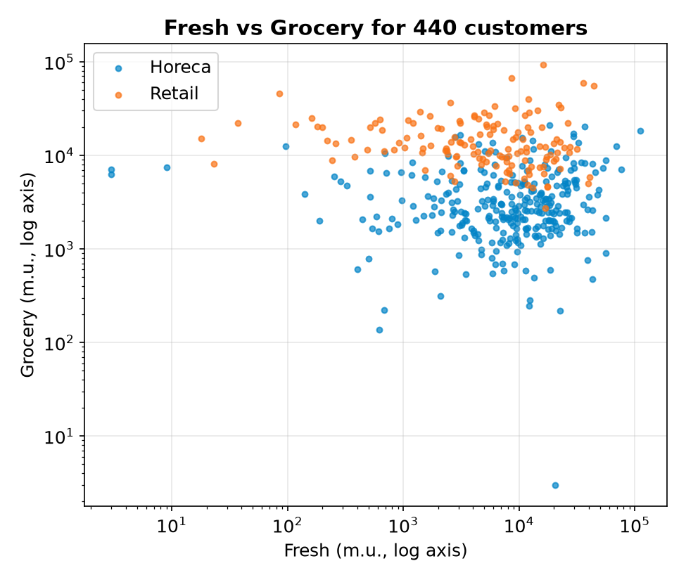
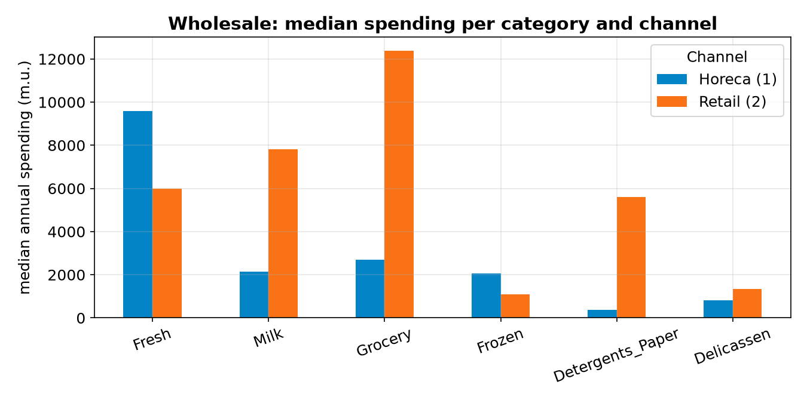
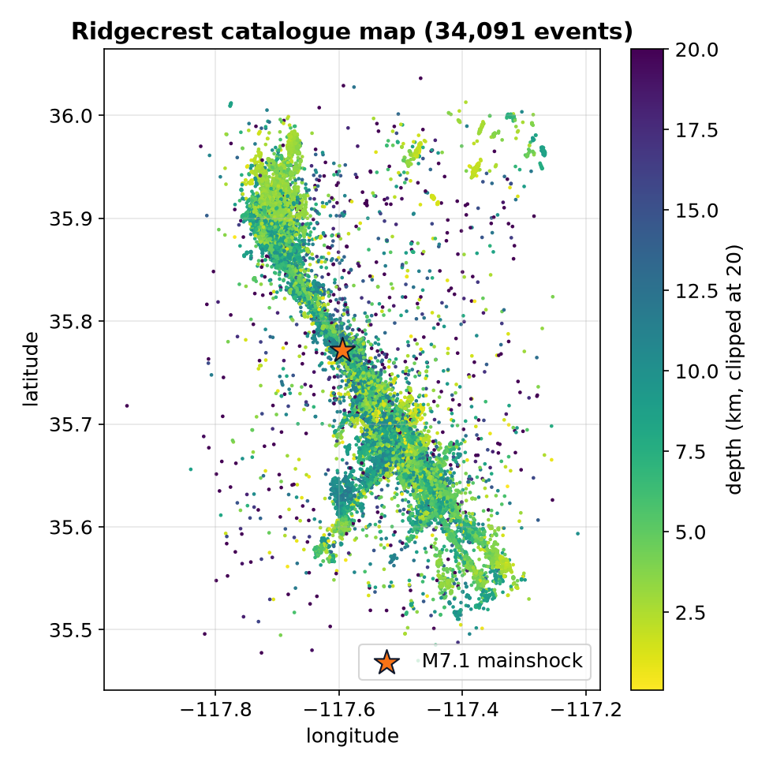
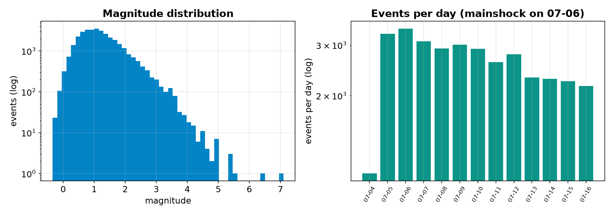
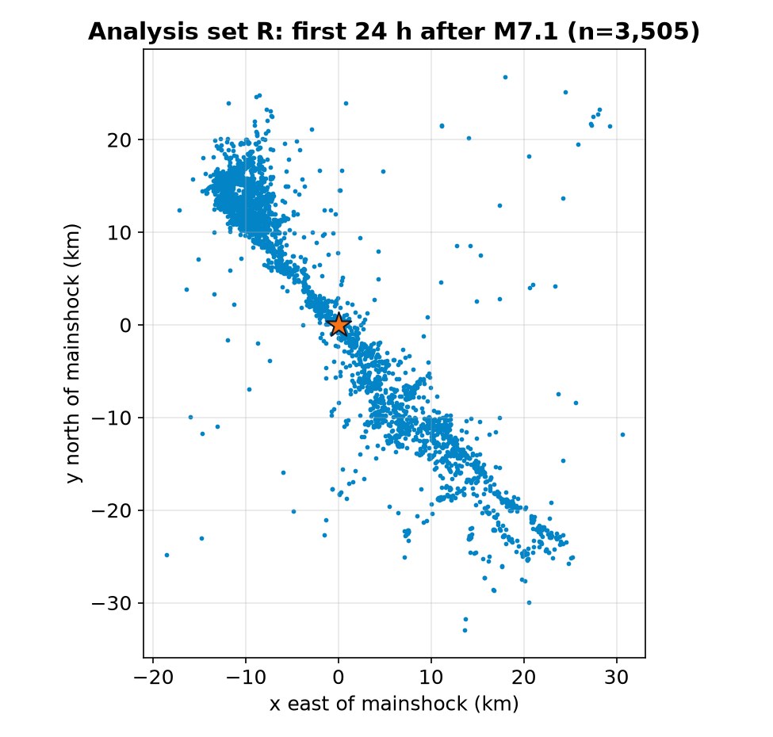

# Datasets used in this project

Two real-world datasets, one for each case study in the notebook. The two **original** files are stored unchanged; every other CSV is *derived* by the notebook and starts with `#` provenance lines (read them with `pd.read_csv(path, comment="#")`).

| File | Kind | Rows | Description |
|---|---|---|---|
| `Wholesale_customers_data.csv` | original | 440 | UCI Wholesale customers |
| `ridgecrest_shelly2019_catalog_raw.txt` | original | 34,091 | USGS Ridgecrest 2019 seismic catalogue |
| `wholesale_S40_analysis_40rows.csv` | derived | 40 | every 11th customer (analysis subset) |
| `wholesale_S8_hand_trace_8rows.csv` | derived | 8 | 8 customers for hand calculations |
| `ridgecrest_R_first24h_after_mainshock.csv` | derived | 3,505 | events in the 24 h after the M7.1 shock, with km coordinates |
| `ridgecrest_H_hand_trace_events.csv` | derived | 22 | small window for the DBSCAN hand trace |
| `ridgecrest_R_dbscan_three_eps_states.csv` | derived | 3,505 | DBSCAN labels for eps = 0.5, 1.0, 2.0 km |

---

## 1. Wholesale customers (UCI, id 292)

* **Source:** <https://archive.ics.uci.edu/dataset/292/wholesale+customers>, DOI 10.24432/C5030X, licence CC BY 4.0.
* **What it is:** annual spending of 440 clients of a Portuguese wholesale distributor.
* **Missing values:** none.

| Column | Type | Meaning |
|---|---|---|
| `Channel` | categorical | 1 = Horeca (hotel/restaurant/cafe, 298 rows), 2 = Retail (142 rows) |
| `Region` | categorical | 1 = Lisbon (77), 2 = Oporto (47), 3 = Other (316) |
| `Fresh` | numeric | annual spending on fresh products (monetary units, m.u.) |
| `Milk` | numeric | annual spending on milk products |
| `Grocery` | numeric | annual spending on grocery products |
| `Frozen` | numeric | annual spending on frozen products |
| `Detergents_Paper` | numeric | annual spending on detergents and paper |
| `Delicassen` | numeric | annual spending on delicatessen |

Mean spending: Fresh 12,000 - Milk 5,796 - Grocery 7,951 - Frozen 3,072 - Detergents_Paper 2,881 - Delicassen 1,525.

**How the notebook uses it.** Only `Fresh` and `Grocery` (after `log10`) enter the distance. `Channel` and `Region` are kept *out* of the distance and only used afterwards to interpret clusters.

**Why it is good for teaching hierarchical clustering.** Spending is strongly right-skewed (skew of Fresh = 2.55, Grocery = 3.58), so a few huge accounts would dominate Euclidean distance. A log transform fixes that, and the two channels behave in opposite ways: Horeca buys more Fresh, Retail more Grocery.





---

## 2. Ridgecrest 2019 earthquake catalogue (USGS, D. Shelly)

* **Source:** <https://www.usgs.gov/data/a-high-resolution-seismic-catalog-initial-2019-ridgecrest-earthquake-sequence>, DOI 10.5066/P9JN6H0N, licence CC0.
* **What it is:** relocated hypocentres of the foreshocks and the first ~11 days of aftershocks of the July 2019 Ridgecrest (California) sequence: 34,091 events, 4 July - 16 July 2019. The largest is the **M7.1 mainshock on 2019-07-06 03:19:52**.
* **Format:** whitespace-separated, `#` header lines, columns `YYYY MM dd hh mm ss.sss lat lon depth mag ID`.

| Column | Meaning |
|---|---|
| `year month day hour minute second` | origin time (treated as UTC) |
| `lat`, `lon` | epicentre in degrees |
| `depth_km` | depth in km (surface taken as 0.7 km above sea level) |
| `mag` | magnitude (SCSN preferred or calibrated ML-like) |
| `event_id` | event identifier (not a CISN ID) |

**Caveat from the data provider:** events are not individually verified, and large errors may exist for some of them. A "cluster" in this project means *a concentration of recorded events*, not automatically a fault.

**How the notebook uses it.** The 3,505 events within 24 h after the mainshock (set **R**) are projected from degrees onto a flat plane in kilometres (centre = mainshock), then clustered with DBSCAN, OPTICS and HDBSCAN on the (x, y) epicentres.





**Why it is good for teaching density-based clustering.** Dense sheets of aftershocks sit next to isolated events (noise), and the density varies across the map, which exposes the single-eps limitation of DBSCAN.

---

## Regenerating the figures

```bash
python scripts/make_dataset_figures.py
```
